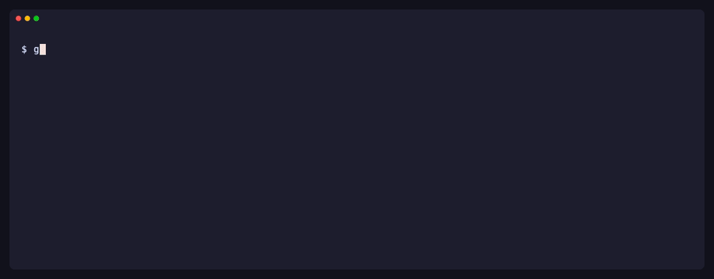
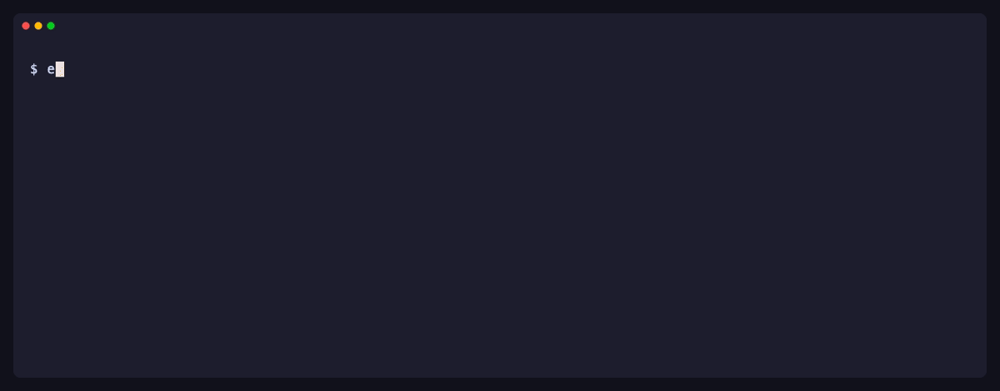

<p align="center">
  
</p>

<p align="center">
  <a href="https://www.npmjs.com/package/jira-delivery-mcp"></a>
  <a href="https://github.com/teransarathchandra/jira-mcp-server/actions/workflows/ci.yml"></a>
  <a href="evals/README.md"></a>
  
  <a href="LICENSE"></a>
</p>

<p align="center">
  An MCP server and agent skill for <b>Jira Cloud</b>. Start a ticket with a ready-to-build brief,<br>
  check your branch against its acceptance criteria before the PR, and hand off — from your coding agent.
</p>

<p align="center">
  <a href="#install"></a>
  <a href="https://cursor.com/install-mcp?name=jira-delivery&config=eyJjb21tYW5kIjoibnB4IiwiYXJncyI6WyIteSIsImppcmEtZGVsaXZlcnktbWNwIl0sImVudiI6eyJKSVJBX0JBU0VfVVJMIjoiaHR0cHM6Ly95b3VyLWRvbWFpbi5hdGxhc3NpYW4ubmV0IiwiSklSQV9FTUFJTCI6InlvdUBleGFtcGxlLmNvbSIsIkpJUkFfQVBJX1RPS0VOIjoieW91ci1hcGktdG9rZW4ifX0%3D"></a>
  <a href="https://insiders.vscode.dev/redirect/mcp/install?name=jira-delivery&inputs=%5B%7B%22type%22%3A%22promptString%22%2C%22id%22%3A%22jira_base_url%22%2C%22description%22%3A%22Jira%20site%20URL%2C%20e.g.%20https%3A%2F%2Fyour-domain.atlassian.net%22%7D%2C%7B%22type%22%3A%22promptString%22%2C%22id%22%3A%22jira_email%22%2C%22description%22%3A%22Atlassian%20account%20email%22%7D%2C%7B%22type%22%3A%22promptString%22%2C%22id%22%3A%22jira_api_token%22%2C%22description%22%3A%22Jira%20API%20token%22%2C%22password%22%3Atrue%7D%5D&config=%7B%22command%22%3A%22npx%22%2C%22args%22%3A%5B%22-y%22%2C%22jira-delivery-mcp%22%5D%2C%22env%22%3A%7B%22JIRA_BASE_URL%22%3A%22%24%7Binput%3Ajira_base_url%7D%22%2C%22JIRA_EMAIL%22%3A%22%24%7Binput%3Ajira_email%7D%22%2C%22JIRA_API_TOKEN%22%3A%22%24%7Binput%3Ajira_api_token%7D%22%7D%7D"></a>
</p>


## How it works

### 1 · Start a ticket

> *"I'm starting ABC-1, get me ready."*

Readiness, blockers, acceptance criteria, next steps and a branch name — before you write a line.


### 2 · Verify before the PR

> *"Check my branch against ABC-1 before I open the PR."*

Your local diff against the acceptance criteria and Definition of Done, with one verdict — `ready_for_pr`, `needs_work` or `insufficient_evidence` — and the files behind each criterion.



### 3 · Hand off

> *"Post the QA handoff to ABC-1."*

QA handoffs, release notes, test plans and reviews. With write-back on, the agent shows you a preview and waits for your approval.



## Install

You need **Node.js 22+**, your Jira Cloud URL, your Atlassian email and an [API token](https://id.atlassian.com/manage-profile/security/api-tokens).

<details open>
<summary> <b>Claude Code</b> — plugin with the server and the skill</summary>

```
/plugin marketplace add teransarathchandra/jira-mcp-server
/plugin install jira-delivery@jira-delivery
```

It asks for your site, email and token (the token goes to secure storage). Without the plugin:

```bash
claude mcp add jira-delivery \
  -e JIRA_BASE_URL=https://your-domain.atlassian.net \
  -e JIRA_EMAIL=you@example.com \
  -e JIRA_API_TOKEN=your-api-token \
  -- npx -y jira-delivery-mcp
```

</details>

<details>
<summary> <b>Cursor</b></summary>

Click **[Add to Cursor](https://cursor.com/install-mcp?name=jira-delivery&config=eyJjb21tYW5kIjoibnB4IiwiYXJncyI6WyIteSIsImppcmEtZGVsaXZlcnktbWNwIl0sImVudiI6eyJKSVJBX0JBU0VfVVJMIjoiaHR0cHM6Ly95b3VyLWRvbWFpbi5hdGxhc3NpYW4ubmV0IiwiSklSQV9FTUFJTCI6InlvdUBleGFtcGxlLmNvbSIsIkpJUkFfQVBJX1RPS0VOIjoieW91ci1hcGktdG9rZW4ifX0%3D)** and replace the three placeholder values, or add the [JSON below](#json-config) to `~/.cursor/mcp.json`.

</details>

<details>
<summary> <b>VS Code</b> (GitHub Copilot agent mode)</summary>

Click **[Install in VS Code](https://insiders.vscode.dev/redirect/mcp/install?name=jira-delivery&inputs=%5B%7B%22type%22%3A%22promptString%22%2C%22id%22%3A%22jira_base_url%22%2C%22description%22%3A%22Jira%20site%20URL%2C%20e.g.%20https%3A%2F%2Fyour-domain.atlassian.net%22%7D%2C%7B%22type%22%3A%22promptString%22%2C%22id%22%3A%22jira_email%22%2C%22description%22%3A%22Atlassian%20account%20email%22%7D%2C%7B%22type%22%3A%22promptString%22%2C%22id%22%3A%22jira_api_token%22%2C%22description%22%3A%22Jira%20API%20token%22%2C%22password%22%3Atrue%7D%5D&config=%7B%22command%22%3A%22npx%22%2C%22args%22%3A%5B%22-y%22%2C%22jira-delivery-mcp%22%5D%2C%22env%22%3A%7B%22JIRA_BASE_URL%22%3A%22%24%7Binput%3Ajira_base_url%7D%22%2C%22JIRA_EMAIL%22%3A%22%24%7Binput%3Ajira_email%7D%22%2C%22JIRA_API_TOKEN%22%3A%22%24%7Binput%3Ajira_api_token%7D%22%7D%7D)** (or [Insiders](https://insiders.vscode.dev/redirect/mcp/install?name=jira-delivery&inputs=%5B%7B%22type%22%3A%22promptString%22%2C%22id%22%3A%22jira_base_url%22%2C%22description%22%3A%22Jira%20site%20URL%2C%20e.g.%20https%3A%2F%2Fyour-domain.atlassian.net%22%7D%2C%7B%22type%22%3A%22promptString%22%2C%22id%22%3A%22jira_email%22%2C%22description%22%3A%22Atlassian%20account%20email%22%7D%2C%7B%22type%22%3A%22promptString%22%2C%22id%22%3A%22jira_api_token%22%2C%22description%22%3A%22Jira%20API%20token%22%2C%22password%22%3Atrue%7D%5D&config=%7B%22command%22%3A%22npx%22%2C%22args%22%3A%5B%22-y%22%2C%22jira-delivery-mcp%22%5D%2C%22env%22%3A%7B%22JIRA_BASE_URL%22%3A%22%24%7Binput%3Ajira_base_url%7D%22%2C%22JIRA_EMAIL%22%3A%22%24%7Binput%3Ajira_email%7D%22%2C%22JIRA_API_TOKEN%22%3A%22%24%7Binput%3Ajira_api_token%7D%22%7D%7D&quality=insiders)). VS Code asks for your site, email and token and stores the token as a secret.

Manually: add to `.vscode/mcp.json` — VS Code uses `servers`, not `mcpServers`:

```json
{
  "servers": {
    "jira-delivery": {
      "type": "stdio",
      "command": "npx",
      "args": ["-y", "jira-delivery-mcp"],
      "env": { "JIRA_BASE_URL": "https://your-domain.atlassian.net", "JIRA_EMAIL": "you@example.com", "JIRA_API_TOKEN": "your-api-token" }
    }
  }
}
```

</details>

<details>
<summary> <b>Windsurf</b> ·  <b>Claude Desktop</b> · any MCP client</summary>

<a id="json-config"></a>Add to the client's MCP config — Windsurf: *Settings → MCP Servers*; Claude Desktop: `claude_desktop_config.json`:

```json
{
  "mcpServers": {
    "jira-delivery": {
      "command": "npx",
      "args": ["-y", "jira-delivery-mcp"],
      "env": { "JIRA_BASE_URL": "https://your-domain.atlassian.net", "JIRA_EMAIL": "you@example.com", "JIRA_API_TOKEN": "your-api-token" }
    }
  }
}
```

</details>

<details>
<summary>⌨️ <b>Codex CLI</b></summary>

In `~/.codex/config.toml`:

```toml
[mcp_servers.jira-delivery]
command = "npx"
args = ["-y", "jira-delivery-mcp"]
env = { JIRA_BASE_URL = "https://your-domain.atlassian.net", JIRA_EMAIL = "you@example.com", JIRA_API_TOKEN = "your-api-token" }
```

</details>

**Check your setup:** with the three variables exported, `npx jira-delivery-mcp doctor` verifies the login and prints the custom-field ids your site needs (acceptance criteria, story points, epic). Other agents can add the [`jira-delivery` skill](plugin/skills/jira-delivery/SKILL.md), also attached to each [release](https://github.com/teransarathchandra/jira-mcp-server/releases).

## Tools

| Step | Tools |
|---|---|
| Start | `jira_search_issues` · `jira_get_issue` · `jira_prepare_work_brief` |
| Verify | `delivery_check_changes` · `delivery_traceability_matrix` |
| Hand off | `delivery_generate` · `jira_add_comment`\* · `jira_update_issue`\* |
| Context | `confluence_search` · `confluence_get_page` · `delivery_project_patterns` · `delivery_generate_agent_pack` |

\* Opt-in with `JIRA_ENABLE_WRITES=true`. Every tool returns typed `structuredContent`; see the [tool reference](docs/tools.md).

## Safe by default

- 🔒 **Local and private** — runs on your machine over stdio; talks only to your Atlassian site; no telemetry.
- ✋ **Read-only unless you opt in** — and then every write is previewed, waits for your approval, is sent once and audited.
- 🧱 **Ticket text is untrusted** — fenced as data, scanned for prompt injection, never turned into instructions.
- 🗝️ **Credentials stay in your environment** — never logged; redacted from all output.

## Documentation

[Usage](docs/usage.md) · [Tools](docs/tools.md) · [Configuration](docs/configuration.md) · [Security](docs/security.md) · [Troubleshooting](docs/troubleshooting.md) · [Migrating from 1.x](docs/migrating-from-v1.md) · [Changelog](CHANGELOG.md)

## Contributing

Issues and pull requests are welcome — see [CONTRIBUTING.md](CONTRIBUTING.md). Security reports: [SECURITY.md](SECURITY.md).

[MIT](LICENSE) © Teran Sarathchandra
